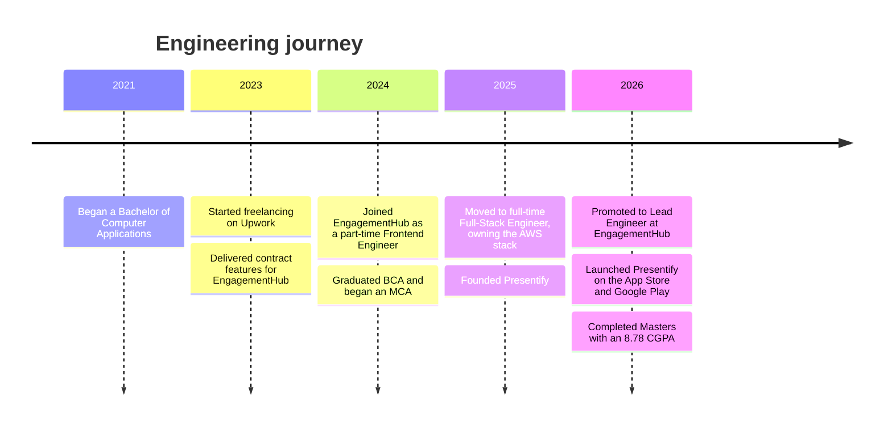

<p align="center">
  <picture>
    <source media="(prefers-color-scheme: dark)" srcset="assets/hero-dark.svg">
    
  </picture>
</p>

<p align="center">
  <a href="https://webwizards.in"></a>
  <a href="https://www.linkedin.com/in/jay-soni-462333229"></a>
  <a href="mailto:jay@webwizards.in"></a>
</p>

<p align="center">
  <em>Full-stack systems · Cloud architecture · AI Integration</em>
</p>

---

##  Engineering overview

I take products from idea to production across web, mobile, cloud and AI. Today I'm the Lead Engineer at **EngagementHub**, an AFSL-compliant SaaS platform for Australian financial advisers.

<table>
  <tr>
    <td width="58%" valign="top">

```ts
const jay = {
  basedIn: "Ahmedabad, India",
  role: "Full-Stack Engineer & Solutions Architect",
  now: "Lead Engineer at EngagementHub",
  thinksIn: ["systems", "trade-offs", "outcomes"],
  mantra: "Simple. Secure. Easy to change.",
  ships: "idea → production → iteration",
  openTo: ["Freelance", "Full-time"],
};

jay.build("something worth shipping");
```

  </td>
  <td valign="middle">
    <p> <strong>I own it end to end</strong><br>From the first requirement to production, and the improvements that follow launch.</p>
    <p> <strong>I design for what's next</strong><br>Simple architecture today that scales, stays secure and is easy to change tomorrow.</p>
    <p> <strong>I make AI earn its place</strong><br>AI built into real workflows, with cost, speed and accuracy kept in check.</p>
  </td>
  </tr>
</table>

##  Featured engineering work

<table>
  <tr>
    <td width="50%" valign="top">
      <h3> EngagementHub</h3>
      <p><strong>AFSL-compliant SaaS for Australian financial advisers.</strong></p>
      <p><strong>Role:</strong> Lead Engineer. I started as a contractor in 2023 and now own features end to end, across the application and the AWS backend.</p>
      <p><strong>Impact:</strong> 230+ commits · 6 AI tools built · 3 years on the product</p>
      <details>
        <summary><strong>Under the hood</strong></summary>
        <ul>
          <li>Built AI-assisted workflows for presentations, reports, insurance summaries, proposals and file notes using Claude on Amazon Bedrock.</li>
          <li>Reworked a stalled AI prototype into an SQS → Lambda → Bedrock pipeline, then moved processing to ECS/ECR when it outgrew Lambda.</li>
          <li>Implemented DocuSign signing with live signer tracking and push notifications.</li>
          <li>Built configurable settings that cascade across dealer groups, practices and advisers.</li>
          <li>Worked across Amplify, AppSync, Lambda, DynamoDB, SQS, S3 and Cognito.</li>
        </ul>
      </details>
      <p><a href="https://www.engagementhub.net">Product website ↗</a></p>
    </td>
    <td width="50%" valign="top">
      <h3> Presentify</h3>
      <p><strong>Face-recognition attendance for schools and colleges.</strong></p>
      <p><strong>Role:</strong> Founder and engineer, from architecture through to the App Store and Google Play release.</p>
      <p><strong>Impact:</strong> 1,200+ students · 430+ lectures · ~20s per class photo</p>
      <details>
        <summary><strong>Under the hood</strong></summary>
        <ul>
          <li>Delivered Flutter mobile apps, a React admin dashboard, a Next.js website and a Node.js/GraphQL API.</li>
          <li>Built a FastAPI face-matching service using InsightFace on Modal's serverless GPUs (29.5s at P95 over 400+ jobs).</li>
          <li>Matched against one centroid embedding per student with an ~8% margin check to cut look-alike false positives.</li>
          <li>Implemented JWT auth with refresh tokens and role-based access across a five-level organisation hierarchy.</li>
        </ul>
      </details>
      <p><a href="https://presentify.in">Product website ↗</a></p>
    </td>
  </tr>
  <tr>
    <td width="50%" valign="top">
      <h3> Savari Dekho</h3>
      <p><strong>A carpooling application for offering rides and booking seats.</strong></p>
      <p><strong>Role:</strong> Full-stack implementation and deployment.</p>
      <p><strong>Impact:</strong> live seat booking with payments, payouts and route maps</p>
      <details>
        <summary><strong>Under the hood</strong></summary>
        <ul>
          <li>MERN application with MongoDB, Express, React and Node.js.</li>
          <li>Integrated Razorpay/RazorpayX payment flows and Google Maps routing.</li>
          <li>Deployed the frontend to Cloudflare Pages and hosted the API separately.</li>
        </ul>
      </details>
      <p><a href="https://savaridekho.webwizards.in">Live demo ↗</a> · <a href="https://github.com/MrJ-2k04/savari-dekho">Source code ↗</a></p>
    </td>
    <td width="50%" valign="top">
      <h3> PriceTrack</h3>
      <p><strong>A used-bike price prediction and model-comparison tool.</strong></p>
      <p><strong>Role:</strong> Data preparation, model training and interactive UI.</p>
      <p><strong>Impact:</strong> 98.2% R² with Random Forest, up from 92.8% with linear regression</p>
      <details>
        <summary><strong>Under the hood</strong></summary>
        <ul>
          <li>Prepared and explored a dataset of 30,000+ used bikes.</li>
          <li>Compared Linear, Ridge, Lasso, Decision Tree, Random Forest and Gradient Boosting models.</li>
          <li>Built a Streamlit interface for comparing predictions across models.</li>
        </ul>
      </details>
      <p><a href="https://github.com/MrJ-2k04/PriceTrack">Source code ↗</a></p>
    </td>
  </tr>
</table>

<details>
  <summary><strong>How I approach engineering</strong></summary>
  <ul>
    <li><strong>Architecture:</strong> choose patterns based on product needs, operational constraints and maintainability.</li>
    <li><strong>Delivery:</strong> own work from requirements and implementation through deployment and iteration.</li>
    <li><strong>AI integration:</strong> account for latency, cost, evaluation and reliability when building model-powered workflows.</li>
    <li><strong>Security:</strong> treat authentication, authorisation and safe defaults as core design concerns.</li>
  </ul>
</details>

##  Technical toolkit

<h4 align="center">💻 Frontend & Mobile</h4>
<p align="center">
  
  
  
  
  
</p>

<h4 align="center">⚙️ Backend & APIs</h4>
<p align="center">
  
  
  
  
</p>

<h4 align="center">📝 Languages</h4>
<p align="center">
  
  
  
  
</p>

<h4 align="center">☁️ Cloud (Amazon Web Services)</h4>
<p align="center">
  
  
  
  <br>
  
  
  
</p>

<h4 align="center">🚀 DevOps & Delivery</h4>
<p align="center">
  
  
  
  
</p>

<h4 align="center">🌐 Hosting & Deployment</h4>
<p align="center">
  
  
  
  
</p>

<h4 align="center">🗄️ Databases</h4>
<p align="center">
  
  
  
  
</p>

<h4 align="center">🤖 AI & Machine Learning</h4>
<p align="center">
  
  
  
  
  
  
</p>

##  Career path



##  GitHub activity

<p align="center">
  <picture>
    <source media="(prefers-color-scheme: dark)" srcset="https://raw.githubusercontent.com/MrJ-2k04/MrJ-2k04/output/pulse-dark.svg">
    
  </picture>
</p>

<p align="center">
  <picture>
    <source media="(prefers-color-scheme: dark)" srcset="https://raw.githubusercontent.com/MrJ-2k04/MrJ-2k04/output/snake-dark.svg">
    
  </picture>
</p>

<p align="center">
  <picture>
    <source media="(prefers-color-scheme: dark)" srcset="assets/footer-dark.svg">
    
  </picture>
</p>

<p align="center">
  Open to thoughtful freelance engagements and full-time opportunities.<br>
  <a href="mailto:jay@webwizards.in">Get in touch ↗</a><br><br>
  
</p>
