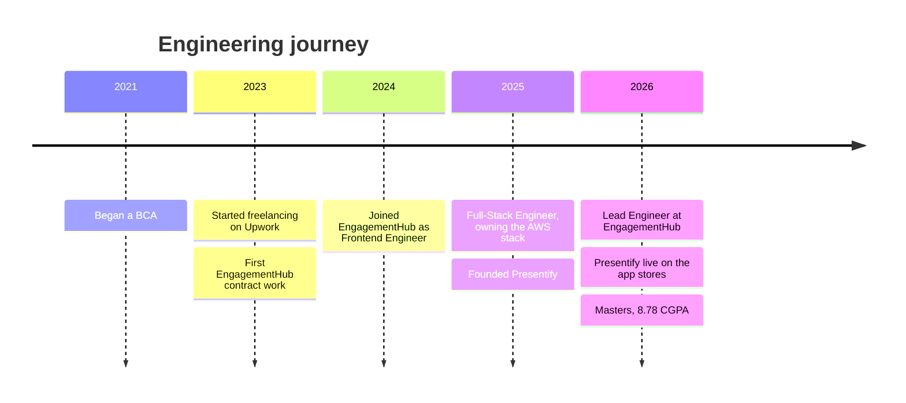

<p align="center">
  <picture>
    <source media="(prefers-color-scheme: dark)" srcset="assets/hero-dark.svg">
    
  </picture>
</p>

<p align="center">
  <a href="https://webwizards.in"></a>
  <a href="https://www.linkedin.com/in/jay-soni-462333229"></a>
  <a href="mailto:jay@webwizards.in"></a>
</p>

<p align="center">
  <em>Full-stack systems · Cloud architecture · AI Integration</em>
</p>

---

##  Engineering overview

I design and build reliable, secure systems across web, mobile, cloud and AI. Today I'm the Lead Engineer at **EngagementHub**, an AFSL-compliant SaaS platform for Australian financial advisers.

<table>
  <tr>
    <td width="58%" valign="top">

```ts
const jay = {
  basedIn: "Ahmedabad, India",
  role: "Full-Stack Engineer & Solutions Architect",
  now: "Lead Engineer at EngagementHub",
  thinksIn: ["systems", "trade-offs", "outcomes"],
  mantra: "Simple. Secure. Easy to change.",
  ships: "idea → production → iteration",
  openTo: ["Freelance", "Full-time"],
};

jay.build("something worth shipping");
```

  </td>
  <td valign="middle">
    <p> <strong>I own it end to end</strong><br>Architecture, delivery and every iteration after launch.</p>
    <p> <strong>I design for what's next</strong><br>Simple, secure, easy to change.</p>
    <p> <strong>I make AI earn its place</strong><br>Built into real workflows, not bolted on.</p>
  </td>
  </tr>
</table>

##  Featured engineering work

<table>
  <tr>
    <td colspan="3" valign="top">
      <h3> EngagementHub</h3>
      <p><strong>AFSL-compliant SaaS for Australian financial advisers.</strong></p>
      <p>Lead Engineer · 230+ commits · 6 AI tools built</p>
      <p><strong>Highlight:</strong> a stalled AI prototype rebuilt as an SQS → Lambda → Bedrock pipeline, later moved to ECS when it outgrew Lambda.</p>
      <details>
        <summary><strong>Under the hood</strong></summary>
        <ul>
          <li>AI workflows for presentations, reports, insurance summaries, proposals and file notes, on Claude and Amazon Bedrock.</li>
          <li>DocuSign signing with live tracking and push notifications.</li>
          <li>Settings that cascade across dealer groups, practices and advisers.</li>
        </ul>
      </details>
      <p><a href="https://www.engagementhub.net">Product website ↗</a></p>
    </td>
  </tr>
  <tr>
    <td width="33%" valign="top">
      <h3> Presentify</h3>
      <p><strong>Face-recognition attendance for schools and colleges.</strong></p>
      <p>Founder and engineer · 1,200+ students · 430+ lectures</p>
      <details>
        <summary><strong>Under the hood</strong></summary>
        <ul>
          <li>Flutter apps, a React admin dashboard, a Next.js site and a Node.js/GraphQL API.</li>
          <li>FastAPI face matching with InsightFace on Modal GPUs, 29.5s at P95.</li>
          <li>One embedding per student, with a margin check against look-alikes.</li>
        </ul>
      </details>
      <p><a href="https://presentify.in">Product website ↗</a></p>
    </td>
    <td width="33%" valign="top">
      <h3> Savari Dekho</h3>
      <p><strong>A carpooling application for offering rides and booking seats.</strong></p>
      <p>Full-stack build · live seat booking, payments and route maps</p>
      <details>
        <summary><strong>Under the hood</strong></summary>
        <ul>
          <li>MERN app with Razorpay payments and Google Maps routing.</li>
          <li>Frontend on Cloudflare Pages, API hosted separately.</li>
        </ul>
      </details>
      <p><a href="https://savaridekho.webwizards.in">Live demo ↗</a> · <a href="https://github.com/MrJ-2k04/savari-dekho">Source code ↗</a></p>
    </td>
    <td width="33%" valign="top">
      <h3> PriceTrack</h3>
      <p><strong>A used-bike price prediction and model-comparison tool.</strong></p>
      <p>Data and ML · 98.2% R² with Random Forest, up from 92.8%</p>
      <details>
        <summary><strong>Under the hood</strong></summary>
        <ul>
          <li>30,000+ used bikes, six models compared from linear to gradient boosting.</li>
          <li>Streamlit app to compare predictions side by side.</li>
        </ul>
      </details>
      <p><a href="https://github.com/MrJ-2k04/PriceTrack">Source code ↗</a></p>
    </td>
  </tr>
</table>

##  Technical toolkit

<p align="center">
  <picture>
    <source media="(prefers-color-scheme: dark)" srcset="assets/toolkit-dark.svg">
    
  </picture>
</p>

##  Career path



##  GitHub activity

<p align="center">
  <picture>
    <source media="(prefers-color-scheme: dark)" srcset="https://raw.githubusercontent.com/MrJ-2k04/MrJ-2k04/output/pulse-dark.svg">
    
  </picture>
</p>

<p align="center">
  <picture>
    <source media="(prefers-color-scheme: dark)" srcset="https://raw.githubusercontent.com/MrJ-2k04/MrJ-2k04/output/snake-dark.svg">
    
  </picture>
</p>

<p align="center">
  <picture>
    <source media="(prefers-color-scheme: dark)" srcset="assets/footer-dark.svg">
    
  </picture>
</p>

<p align="center">
  Open to freelance and full-time work.<br>
  <a href="mailto:jay@webwizards.in">Get in touch ↗</a><br><br>
  
</p>
