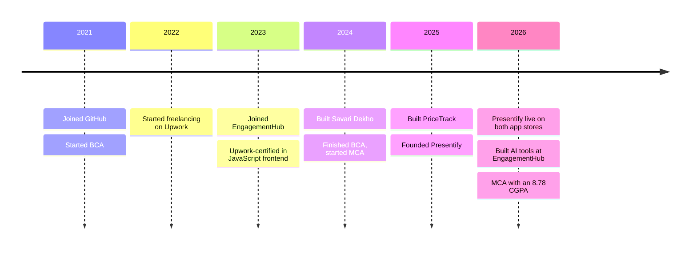

<picture>
  <source media="(prefers-color-scheme: dark)" srcset="assets/header-dark.svg">
  <source media="(prefers-color-scheme: light)" srcset="assets/header-light.svg">
  
</picture>

<h3 align="center">Engineering ideas into production-ready software.</h3>
<p align="center">Full-stack applications · Cloud architecture · AI integration</p>

<p align="center">
  <a href="https://webwizards.in"></a>
  <a href="https://www.linkedin.com/in/jay-soni-462333229"></a>
  <a href="mailto:jay@webwizards.in"></a>
</p>

<br>

I design, build and deploy production software, from full-stack web and mobile apps to cloud infrastructure and AI-powered features. For the last three years I've been a core engineer on **EngagementHub**, a platform Australian financial advisers use to run their practices, and I've shipped products of my own along the way.

```js
const jay = {
  basedIn: "Ahmedabad, India 🇮🇳",
  now: "Shipping AI features on AWS for EngagementHub",
  coreStack: ["React", "Node.js", "AWS", "Python"],
  into: ["Serverless & GPU infra", "Applied AI", "Secure-by-default systems"],
  openTo: ["Freelance", "Full-time"],
};
```

<br>

## ✦ Selected work

<table>
  <tr>
    <td width="50%" valign="top">
      <h3>💼 EngagementHub</h3>
      <p><b>An all-in-one platform for financial advisers and dealer groups in Australia.</b></p>
      <p><b>My role:</b> full-stack engineer since 2023, taking features from design through to production on a React and AWS serverless stack.</p>
      <p>📈 <b>230+</b> commits · <b>6</b> AI tools built · <b>3</b> years on the product</p>
      <details>
        <summary><b>Under the hood</b></summary>
        <br>
        <ul>
          <li>AI presentations, reports, insurance summaries, proposals and file notes, generated with Claude on AWS Bedrock</li>
          <li>Rebuilt a stalled AI prototype as an SQS → Lambda → Bedrock pipeline, then moved it to ECS/ECR when it outgrew Lambda</li>
          <li>Production DocuSign signing with live signer tracking and push notifications</li>
          <li>Settings that cascade from dealer groups to practices to advisers</li>
          <li>Built on Amplify, AppSync (GraphQL), Lambda, DynamoDB, SQS, S3 and Cognito</li>
        </ul>
      </details>
      <a href="https://www.engagementhub.net"></a>
    </td>
    <td width="50%" valign="top">
      <h3>📸 Presentify</h3>
      <p><b>Face recognition attendance for schools and colleges.</b></p>
      <p><b>My role:</b> founder and sole engineer, from the architecture to the App Store and Google Play launch.</p>
      <p>📈 <b>1,200+</b> students · <b>430+</b> lectures · <b>~20s</b> per class photo</p>
      <details>
        <summary><b>Under the hood</b></summary>
        <br>
        <ul>
          <li>Flutter app, React admin dashboard, Next.js site and a Node/GraphQL API</li>
          <li>FastAPI + InsightFace matching on Modal's serverless GPUs (29.5s at P95 over 400+ jobs)</li>
          <li>One centroid embedding per student plus an ~8% margin cut look-alike false positives</li>
          <li>JWT with refresh tokens and role-based access across a five-level hierarchy</li>
        </ul>
      </details>
      <a href="https://presentify.in"></a>
    </td>
  </tr>
  <tr>
    <td width="50%" valign="top">
      <h3>🚗 Savari Dekho</h3>
      <p><b>A carpooling app where drivers offer rides and passengers book and pay for seats.</b></p>
      <p><b>My role:</b> built the whole stack and deployed it on my own domain.</p>
      <p>📈 Live payments and route maps, end to end</p>
      <details>
        <summary><b>Under the hood</b></summary>
        <br>
        <ul>
          <li>MERN stack: MongoDB, Express, React and Node.js</li>
          <li>Razorpay and RazorpayX for payments and payouts, Google Maps for routing</li>
          <li>Frontend on Cloudflare Pages, API on self-managed hosting</li>
        </ul>
      </details>
      <a href="https://savaridekho.webwizards.in"></a>
      <a href="https://github.com/MrJ-2k04/savari-dekho"></a>
    </td>
    <td width="50%" valign="top">
      <h3>📈 PriceTrack</h3>
      <p><b>Predicts used bike prices and compares six models side by side.</b></p>
      <p><b>My role:</b> data cleaning, modelling and the interactive UI.</p>
      <p>📈 <b>98.2%</b> R² with Random Forest, up from 92.8% with linear regression</p>
      <details>
        <summary><b>Under the hood</b></summary>
        <br>
        <ul>
          <li>Cleaned and explored a dataset of 30,000+ used bikes</li>
          <li>Linear, Ridge, Lasso, Decision Tree, Random Forest and Gradient Boosting models</li>
          <li>A Streamlit UI shows live predictions from all six models</li>
        </ul>
      </details>
      <a href="https://github.com/MrJ-2k04/PriceTrack"></a>
    </td>
  </tr>
</table>

<br>

## ✦ Journey



<br>

## ✦ Toolbox

<table>
  <tr>
    <td width="150"><b>Frontend</b></td>
    <td></td>
  </tr>
  <tr>
    <td><b>Backend</b></td>
    <td></td>
  </tr>
  <tr>
    <td><b>Data</b></td>
    <td></td>
  </tr>
  <tr>
    <td><b>Cloud</b></td>
    <td></td>
  </tr>
  <tr>
    <td><b>Languages</b></td>
    <td></td>
  </tr>
  <tr>
    <td><b>AI</b></td>
    <td>AWS Bedrock (Claude) · InsightFace · ONNX Runtime</td>
  </tr>
</table>

<br>

## ✦ GitHub pulse

<picture>
  <source media="(prefers-color-scheme: dark)" srcset="https://raw.githubusercontent.com/MrJ-2k04/MrJ-2k04/output/pulse-dark.svg">
  
</picture>

<details>
  <summary><b>🐍 Watch a snake eat my contribution graph</b></summary>
  <br>
  <picture>
    <source media="(prefers-color-scheme: dark)" srcset="https://raw.githubusercontent.com/MrJ-2k04/MrJ-2k04/output/snake-dark.svg">
    
  </picture>
</details>

<br>


<p align="center">
  Open to freelance and full-time work. The fastest way to reach me is <a href="mailto:jay@webwizards.in">email</a>.
  <br><br>
  
</p>
